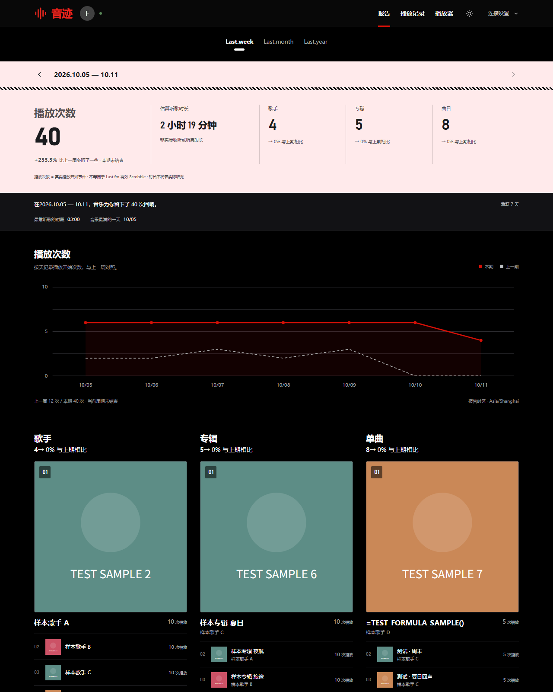
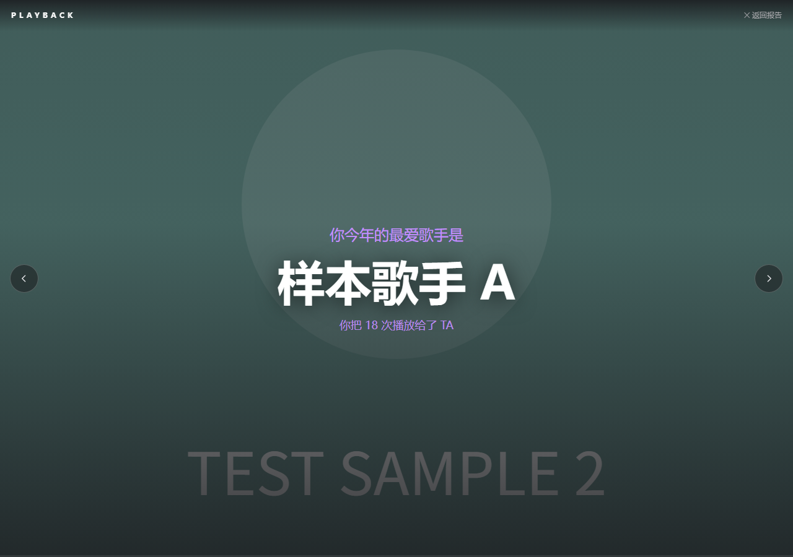
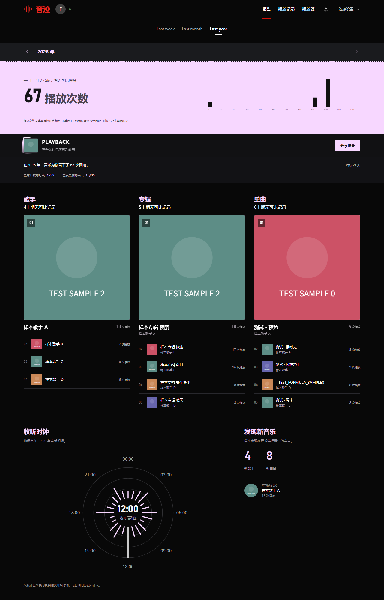
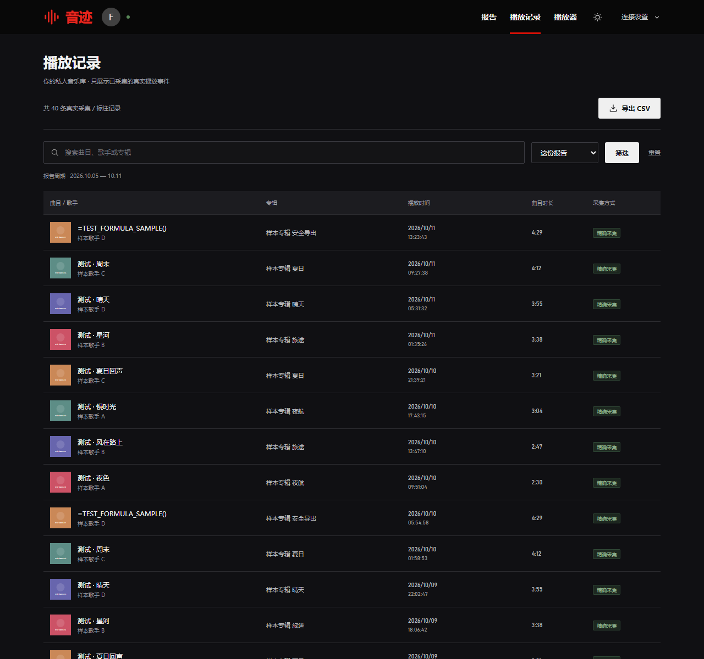
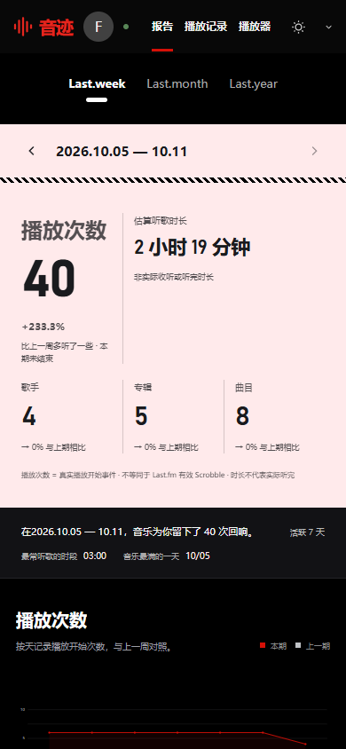

# 音迹 · 飞牛音乐播放统计

> **v0.1 初版发布。** 项目目前还处于早期阶段，功能可用但很多地方不够完善，界面、细节与兼容性都会在后续版本陆续打磨。欢迎提 Issue 反馈问题与建议。

音迹是一个部署在[飞牛 fnOS](https://www.fnos.com/) 上的私人听歌统计工具，为飞牛音乐（fnMusic）提供 Last.fm 风格的周 / 月 / 年收听报告、播放记录档案与年度「Playback」音乐故事。数据只保存在你自己的 NAS 上，不上传任何外部服务。

| 周报告（桌面） | 年度 Playback 故事 |
| --- | --- |
|  |  |

| 年报告 | 播放记录 | 移动端 |
| --- | --- | --- |
|  |  |  |

## 功能

- **周 / 月 / 年报告**：播放次数、估算时长、歌手 / 专辑 / 单曲 Top 榜、收听时钟、星期分布、24 小时热力趋势、音乐年代、流派标签、收听比例、快速事实与新音乐探索。
- **年度 Playback 故事页**：在年报点击 PLAYBACK 横幅，全屏逐屏回顾这一年的音乐（复刻 Last.fm Playback 的观感），支持深链直达：`#playback` 打开故事，`#playback/5` 直达第 6 屏。
- **播放记录**：分页浏览全部已采集的播放事件，支持曲目 / 歌手 / 专辑搜索、周期与自定义日期筛选、CSV 导出。
- **顶栏「飞牛音乐」入口**：一键打开你自己的音乐服务原地址，正常播放即可。
- **备份与恢复**：设置弹窗可随时下载完整备份 JSON（播放记录、曲目元数据、歌手图片），或导入备份文件——**合并去重**（可把另一个账号的导出并入当前账号，相同播放自动去重）或**恢复替换**（清空当前记录后完整还原）。播放数据本身保存在应用数据目录的数据库中，建议定期把备份下载到 NAS 之外保存。
- **移动端适配**：手机浏览器下自动切换单列布局，适合随时查看。
- **日间 / 夜间模式**：一键切换，偏好保存在浏览器本地。

## 播放是怎么被记录的

音迹通过**轮询探测**记录播放：后台每 30 秒读取一次飞牛播放历史。飞牛的历史接口按曲目去重、没有播放时间字段，因此首次出现的曲目按「首次发现时间」补记为 `observed`（估算）；单一已有条目前移到列表首位时识别为一次重播。网页、手机 App 等任何来源的播放都会被这条通道记录，但时间不精确，同一轮询间隔内连续快速切歌可能漏记。

> 早期版本提供过 `/music/` 透明代理采集通道，实测在部分飞牛版本上会干扰登录会话（代理页播放触发令牌轮换，浏览器与音迹同时提示登录失效），自 v0.3.0 起已彻底移除。

## 安装

### 方式一：飞牛应用（推荐）

1. 从 [Releases](../../releases) 下载 `fnmusic-journal.fpk`。
2. fnOS 应用中心 → 手动安装 → 选择该文件。
3. 打开应用，填写飞牛音乐地址（默认预填 NAS 本机 `http://127.0.0.1:5666`）与飞牛音乐账号密码即可。音乐密码不一定等于 NAS 登录密码。

安装后应用以独立用户运行在 5678 端口，数据保存在应用数据目录（升级保留、卸载删除）。

### 方式二：手动运行

需要 Python 3.10+，全部使用标准库，无 pip / Node / 数据库依赖：

```sh
python -m app.server                # 默认监听 127.0.0.1:5678
python -m app.server --host 0.0.0.0 # 局域网访问
```

支持 `--host --port --data-dir --music-server --timezone --poll-seconds` 等参数及对应环境变量，详见 `python -m app.server --help`。

## 使用

1. 首次打开页面，在「连接设置」里完成飞牛音乐账号登录（首次连接只同步曲库元数据，不回填旧历史）。
2. 正常使用飞牛音乐（网页或手机 App）听歌即可，播放由轮询探测自动记录，无需额外操作。
3. 内网设备自动共用已保存的账号（无需每台设备重复登录）；可用 `JOURNAL_TRUST_LAN=0` 关闭。若在飞牛 APP 内置浏览器等会拦截 Cookie 的环境中使用，音迹也会通过本地存储的会话令牌工作，登录一次即可正常使用。

## 数据与隐私

- **所有数据（播放记录、会话、飞牛访问令牌）只保存在 NAS 本地**，不向 Last.fm 或任何外部服务发送账号或听歌记录。
- 播放次数是飞牛真实播放事件，不等同于 Last.fm 有效 Scrobble；时长按曲目长度累加估算，不代表实际听完时长。
- 没有日期的旧播放历史不会被回填成报告；报告从安装当天开始积累。
- HttpOnly 会话、跨站写请求校验、账号数据隔离、CSV 公式注入防护；不要把 5678 端口直接暴露到公网。

## 从源码构建 FPK

需要官方 fnpack 打包工具（放入 `packaging/tools/`，见飞牛开发者文档）：

```sh
python packaging/build.py          # 复制载荷、生成图标、调用 fnpack
python packaging/verify_fpk.py     # 校验包结构与载荷一致性
python packaging/smoke_payload.py  # 解包并实际启动验证
```

运行测试（Python 3.10+ 与 Node）：

```sh
python -m unittest discover -s tests -v
node tests/test_collector.js
```

测试全部使用临时目录、本地回环假 NAS 与模拟数据，不写入真实数据、不向真实 NAS 发起播放。`scripts/preview_fixture.py` 可启动一个带 67 条模拟播放的独立预览服务（端口 5679），用于无账号体验完整界面；`scripts/inject_test_data.py` 可向本地数据库注入一年量的合成播放用于全功能测试（`--clean` 清除）。

## 已知限制

- 飞牛播放历史接口按曲目去重且无播放时间字段，播放时间为估算，重播识别是启发式的，快速连续切歌可能漏记。
- 长时间离线后，轮询只能对齐最近一页历史（约 100 条），更早的缺口无法补回。
- 直接访问飞牛原音乐页（不经音迹代理）的播放依赖轮询通道，时间精度有限。
- 接口升级可能需要更新连接器。

## 版本

**v0.3.3**：顶栏移除「飞牛音乐」入口。

**v0.3.2**：修复封面在禁用 Cookie 的浏览器中无法加载（图片请求改用带令牌的 URL）；令牌存储增加 Cookie 回退（内置浏览器禁用 localStorage 时仍能保持登录，不再每次重新登录）；设置弹窗新增「本设备无法自动连接？点此恢复」一键清除退出标记；新增 `/api/diagnostics` 诊断接口。

**v0.3.1**：会话不再依赖 Cookie——登录成功时令牌同时交给页面，请求经 `X-Journal-Session` 头回传，在拦截 Cookie 的内置浏览器/隐私模式下也能正常建立会话；完整备份下载同样经会话头获取。

**v0.3.0**：移除透明代理（修复部分飞牛版本上代理页导致登录会话失效的问题）；播放记录统一由轮询探测完成；顶栏「飞牛音乐」直接打开你的音乐服务原地址。

**v0.2.1**：移除自动实时备份（播放数据以数据库为准，减少写盘；保留手动下载备份与导入恢复/合并）。

**v0.2**：新增备份与恢复（完整导出、导入合并 / 恢复）；应用图标修正为音迹标志。

**v0.1**：首个公开版本。初版功能可用，但仍有不少不完善之处，后续会陆续改进——包括更精细的重播识别、更完整的移动端细节、更好的文档与安装体验。

## 面向

飞牛 fnOS 用户；如果你在用飞牛音乐又想要一份属于自己的、不上传任何第三方的听歌统计，这就是为你准备的。
